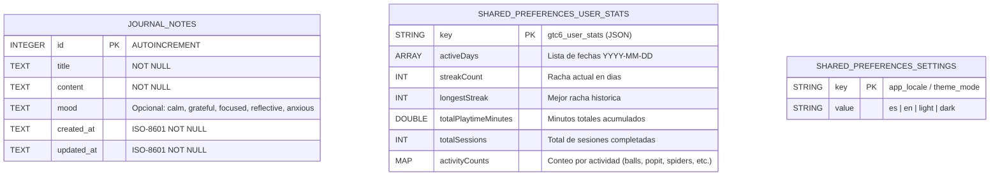

# Estructura de Base de Datos y Persistencia Local — GTC6

Este documento describe cómo se almacenan los datos localmente dentro de la aplicación **GTC6** para consulta y evolución futura (incluyendo posible sincronización con backend).

---

## 1. Resumen de Almacenamiento Local

La aplicación utiliza dos mecanismos complementarios:

1. **Base de datos relacional SQLite (`gtc6_local.db`)** — gestionada por el Singleton [`LocalDatabaseService`](../lib/core/database/local_database_service.dart):
   - Almacena datos estructurados y colecciones que crecen con el tiempo (como las notas del **Diario Personal**).
2. **Almacenamiento Clave-Valor (`SharedPreferences`)** — gestionado por [`ProgressService`](../lib/features/progress/domain/services/progress_service.dart) y [`LocaleController`](../lib/core/i18n/locale_controller.dart):
   - Almacena preferencias simples y el resumen de estadísticas/racha del usuario.

---

## 2. Diagrama de Estructura (Mermaid)



---

## 3. Detalle de la Base de Datos SQLite (`gtc6_local.db`)

- **Versión actual del esquema:** `1`
- **Motor:** `sqflite` (SQLite embebido en el dispositivo)

### Tabla: `journal_notes`
Almacena las entradas del **Diario Personal** del usuario.

| Columna | Tipo SQLite | Restricciones | Descripción |
| :--- | :--- | :--- | :--- |
| `id` | `INTEGER` | `PRIMARY KEY AUTOINCREMENT` | Identificador único de la nota. |
| `title` | `TEXT` | `NOT NULL` | Título de la nota. |
| `content` | `TEXT` | `NOT NULL` | Cuerpo o contenido de la reflexión/nota. |
| `mood` | `TEXT` | `NULL` | Etiqueta opcional de estado de ánimo (`calm`, `grateful`, `focused`, `reflective`, `anxious`). |
| `created_at` | `TEXT` | `NOT NULL` | Fecha y hora de creación en formato ISO-8601. |
| `updated_at` | `TEXT` | `NOT NULL` | Fecha y hora de última modificación en formato ISO-8601. |

#### Índices
- `idx_journal_notes_updated_at`: índice descendente sobre `updated_at DESC` para listar las notas más recientes de forma rápida.

#### DDL de creación
```sql
CREATE TABLE journal_notes (
  id INTEGER PRIMARY KEY AUTOINCREMENT,
  title TEXT NOT NULL,
  content TEXT NOT NULL,
  mood TEXT,
  created_at TEXT NOT NULL,
  updated_at TEXT NOT NULL
);

CREATE INDEX idx_journal_notes_updated_at
ON journal_notes (updated_at DESC);
```

---

## 4. Notas para Evolución Futura (Backend / Nuevas Tablas)
- Al incrementar `_dbVersion` en [`LocalDatabaseService`](../lib/core/database/local_database_service.dart), se puede implementar `onUpgrade` para agregar nuevas tablas (por ejemplo `activity_sessions` o `sync_queue` con un campo `synced_at` / `remote_id`) sin perder las notas existentes del usuario.
